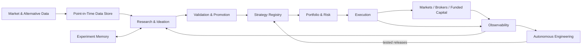

# Algua — Vision of Record

**Status:** North Star / product vision of record  
**Owner:** Lior Nisimov  
**Purpose:** Define what Algua is optimizing for, what it should become, and the constraints future development must respect.

When an implementation plan, architecture proposal, issue, agent decision, or feature conflicts with this document, either the implementation changes or this document is deliberately amended.

---

# 1. North Star

Algua is a **mostly autonomous quantitative trading company**.

Its purpose is to continuously:

1. discover market inefficiencies,
2. formulate falsifiable trading hypotheses,
3. test them honestly,
4. preserve everything learned,
5. deploy validated strategies,
6. combine weakly correlated edges into portfolios,
7. operate them safely with minimal human intervention,
8. learn from trading and software failures,
9. repair and improve its own codebase,
10. scale successful strategies across personal and compatible external capital.

The ultimate product is **net trading profit**.

The software, research infrastructure, agents, models, dashboards, datasets and automation exist to produce that outcome.

Technical sophistication has no intrinsic value if it does not improve:

- expected net P&L,
- capital scalability,
- risk,
- autonomy, or
- research learning rate.

**One-sentence product definition (2026-10-30).** Algua is a mostly autonomous, personally funded quantitative investing system: a high-throughput, multimodal research factory discovers and rigorously evaluates diverse trading strategies, while a deterministic portfolio and execution engine allocates limited capital among independently credible edges.

The ultimate outcome remains net risk-controlled investment profit, not the number of agents, backtests, features or strategies. Initial account ownership is strictly personal; future external capital remains a separate, gated expansion (§22). There is no new authority to manage client capital.

---

# 2. Priority order

When objectives conflict, optimize in this order:

1. **Net profitability**
2. **Capital scalability**
3. **Risk control**
4. **Autonomy**
5. **Research learning rate**
6. **Code quality and simplicity**
7. Everything else

Clean engineering is an important enabler, but Algua is not a software architecture project.

---

# 3. Economic thesis

Algua does not attempt to compete with large funds by copying their operating model.

Its advantage can come from opportunities that are attractive to relatively small capital but too capacity-constrained, operationally inconvenient, short-lived, or economically insignificant for very large institutions.

Candidate sources of edge include:

- institutional and whale-flow effects,
- event-driven information,
- cross-sectional effects,
- momentum,
- mean reversion,
- liquidity effects,
- volatility structure,
- fundamental mispricing,
- news and filing interpretation,
- market microstructure,
- behavioral effects,
- alternative-data signals,
- ML-derived patterns,
- LLM-derived structured information,
- and new hypotheses discovered by the research system.

No single thesis is privileged permanently.

Algua should search broadly while demanding strong evidence before allocating meaningful capital.

**Volatility is not mispricing.**

A market or asset should be targeted because there is a plausible mechanism that could create exploitable expected value after costs, not simply because its price moves frequently.

---

# 4. AI and LLM thesis

AI is a force multiplier for Algua, not a substitute for statistical discipline.

LLMs may participate in:

- literature and web research,
- hypothesis generation,
- strategy design,
- feature discovery,
- financial-report interpretation,
- news interpretation,
- structured extraction from unstructured information,
- coding,
- experiment analysis,
- anomaly investigation,
- incident repair,
- experiment-memory synthesis,
- and research prioritization.

ML, deep learning and LLM-derived signals are first-class strategy capabilities.

However:

**portfolio construction, risk enforcement and execution remain deterministic, inspectable and testable.**

An AI component receives no statistical shortcut because it is intelligent or pretrained.

It must demonstrate incremental economic value against credible simpler baselines.

Where local/open models produce economically equivalent results, prefer them to paid remote models.

Model choice is ultimately based on measured value, not ideology.

OpenCode is the multi-model research harness, with role-scoped agents and skills. Agent sessions are for hypothesis creation, strategy authorship and interpretation; deterministic programs perform large parameter sweeps and metrics, avoiding an LLM call per numerical trial. No autonomous agent places brokerage orders.

---

# 5. One Algua, not prod Algua versus dev Algua

There is **one product, one repository and one architecture**.

There is no separately maintained production fork.

Development continues while trading operates.

The distinction is between:

- the evolving codebase, and
- immutable strategy/software artifacts currently entrusted with capital.

The running system may intentionally execute an older approved artifact while development moves forward.

That is not duplicated development. It is reproducibility.

A strategy that generated evidence must be executable as the same artifact later.

Changes produce new artifacts rather than silently mutating existing ones.

---

# 6. Architecture

Algua should remain understandable as a clean flow:



The desired implementation style is:

**modular monolith + isolated live runtime + background workers**

Do not introduce microservices unless a demonstrated operational or scaling requirement makes them clearly superior.

Core conceptual modules are:

`data → research → experiment memory → strategy registry → portfolio/risk → execution → observability → autonomous engineering`

The diagram should remain clean as the system grows.

If explaining Algua requires a spaghetti diagram, that is an architectural warning.

### Three-harness ownership (owner direction 2026-10-30)

The approved target gives each responsibility one owner. It is direction, not a new runtime permission; see §§18–19 and the [three-harness design](superpowers/specs/2026-10-30-algua-three-harness-design.md).

- **Hermes / Nix OS, the company harness,** is project owner, engineering organization, CI/CD maintainer, system monitor and incident responder. Hermes developers own changes to the underlying engine, data, portfolio, execution, operator, security and UI code.
- **OpenCode, the research harness,** independently runs agentic research operations: ideation, strategy authoring, experiment interpretation and accumulated learning. It never edits the trusted engine or promotion gates, and it operates without Hermes online.
- **Algua, the quant engine,** owns deterministic, independently verifiable data access, simulation, scoring, promotion, portfolio and risk decisions, broker execution and ledgers.

Three loops follow from that split:

- **Research (OpenCode):** inspect past knowledge → source a new hypothesis → deduplicate → implement an isolated strategy → execute deterministic Algua research → record the complete outcome and lineage → independently review survivors → allocate the next research budget.
- **Engineering improvement (Hermes):** read aggregate operational telemetry → deduplicate incidents and bottlenecks → scope work → implement and test on isolated branches → independently verify → release under the authority in §§18–19 → verify before resolving. It does not rewrite research conclusions, edit experiment rows or claim that a failed hypothesis is a bug.
- **Trading (Algua):** verify data and the deployed artifact → evaluate targets → apply risk → reconcile orders and positions → send permitted paper or explicitly authorized live orders → audit. Scheduling, durable markers and locks stay independent of Hermes and OpenCode availability.

The target private monitor home is a **Strategy Leaderboard**: one row per stable strategy identity with its real lifecycle tag, latest relevant OOS metrics, data tier, sample size, freshness and evidence health, explicit sorting by observed OOS Sharpe, return or drawdown, and filtering by stage or family. Live Sharpe is not compared with backtest Sharpe without segmentation. Missing evidence stays UNKNOWN, never 0. A row opens an evidence-rich detail page, the bottom four-tab navigation is removed, and safety and operations status stay reachable in a secondary area. Sorting is exploratory and carries no promotion authority.

---

# 7. Strategy contract

Strategy logic should be pure and broker-agnostic.

Conceptually:

`point-in-time inputs → target portfolio intent`

Broker-specific behavior belongs in execution adapters.

The same strategy implementation should travel through:

`backtest → shadow → paper → experimental live → scaled live`

Do not create separate strategy implementations for each environment.

A strategy may contain:

- deterministic rules,
- fitted statistical models,
- ML models,
- deep-learning models,
- LLM/agentic components,
- or combinations of them.

Models and LLM providers should be hot-swappable through stable interfaces.

Changing a behavior-affecting model creates a new strategy artifact requiring evaluation.

The target contract is one unified multimodal abstraction:

1. A **strategy** is a testable, versioned source of expected relative investment opportunity, with declared data capabilities, temporal availability, parameters and model identity. Its standard output is a finite per-symbol score. It has no broker, account, network or secret access. Rules, statistics, ML, DL, news, fundamentals and mixtures use the same as-of interface, with versioned model artifacts and no inference-time training.
2. **Within-strategy portfolio construction** converts scores into target weights using a declared deterministic policy and may include risk-tightening and exit rules, preserving cash and long-only constraints.
3. **Across-strategy allocation** is defined in §13.
4. **Execution** submits and reconciles orders only after an independently enforced policy and risk decision, using as-of available information and the existing `t -> t+1` rule. No autonomous agent places brokerage orders.

The full multimodal architecture is not deferred by the limits of initial data (§11).

---

# 8. Research philosophy

Algua should generate ideas broadly but operate only a **small portfolio of deeply validated strategies**.

Research follows a lightweight mandatory loop:

`hypothesis → rationale → falsification criteria → experiment → robustness → conclusion → learned knowledge`

Agents may invent entirely new strategy families.

They are not restricted to tuning existing strategies.

Every hypothesis must nevertheless contain:

- an economic or behavioral rationale,
- a falsifiable claim,
- an explicit experiment,
- and criteria under which the idea should be rejected.

Negative results are valuable outputs.

Correctly proving that something does **not** work reduces future search space.

The target top of funnel is large and diverse: cheap screening, then increasingly rigorous evidence. Discover across momentum, reversal, earnings and events, fundamental, quality, ML and novel families, without capping the research space to permanent categories. Preserve all attempted variants and failures, including their effective search breadth.

Reserve research capacity for novel families, not just exploitation of apparent historical winners, with bounded concurrency and compute, recorded budget and use, and evidence-based reallocation. The exact split is an implementation default to benchmark.

Exploratory and portfolio-deployable evidence must be visibly different.

---

# 9. Experiment memory is a moat

Algua should become smarter because it remembers what it has already learned.

Every meaningful experiment—successful or failed—becomes permanent structured knowledge.

At minimum, record:

- hypothesis,
- economic rationale,
- strategy family,
- parent experiment,
- data snapshot/version,
- point-in-time assumptions,
- code commit,
- strategy artifact,
- configuration,
- model identity,
- parameters,
- transaction-cost assumptions,
- metrics,
- robustness results,
- artifacts,
- conclusion,
- failure reason,
- and lessons learned.

For LLM-dependent experiments also preserve:

- provider,
- model/version,
- prompt,
- timestamp,
- inputs,
- raw response,
- and structured derived output.

Agents must search prior experiments before proposing new research.

Re-running substantially equivalent research requires an explicit explanation of what changed.

Maintain a **strategy genealogy**:

`idea → experiment → modification → descendant → deployment`

The system should automatically maintain synthesized knowledge such as:

- what we know about momentum,
- what has failed in event-driven research,
- which assumptions repeatedly break,
- which markets exhibit which effects,
- which model families added value,
- and which promising directions remain unexplored.

The accumulated experiment graph is part of Algua's long-term intellectual property.

Every variant must record hypothesis and falsification, family and parent, data tier and snapshot, code, config and model versions, cost assumptions, trial count, metrics, error reason and decision. There must be a durable record for failed runs, not only successes.

Preserve one authoritative experiment and strategy ledger: the SQLite registry, MLflow and linked Git and knowledge-base records. Do not mirror every experiment to Hermes Kanban or create a second research database.

---

# 10. Reproducibility and research integrity

A backtest must be reproducible from:

`code + artifact + data version + configuration + environment`

If a result cannot be reproduced, it cannot justify promotion.

Historical evaluation must be point-in-time correct.

Particular care is required for:

- universe membership,
- corporate actions,
- delistings,
- fundamentals,
- filings,
- news,
- macroeconomic releases,
- alternative data,
- and LLM inputs.

Mandatory robustness should include, where applicable:

- true out-of-sample evaluation,
- walk-forward testing,
- realistic transaction costs,
- slippage assumptions,
- parameter sensitivity,
- regime analysis,
- liquidity checks,
- capacity checks,
- simple baselines,
- correlation with existing strategies,
- and awareness of repeated/multiple hypothesis testing.

Repeatedly searching the same historical data must never masquerade as independent confirmation.

Do not weaken gates to make weak two-year evidence qualify. A simulated or historical replay cannot be described as elapsed forward paper evidence. Correct multiple-testing treatment, untouched validation data and actual forward elapsed observations matter more than a nominal Sharpe on a two-year snapshot. If no candidate passes a real gate, that is a valid research result, not a failed system demonstration.

---

# 11. Data

Algua should own a **canonical local, versioned historical dataset**.

External vendors are upstream sources, not the sole authority for reproducibility.

Initial first-class data:

1. OHLCV,
2. fundamentals,
3. timestamped news,
4. timestamped filings.

Add options, order books, alternative data and specialized sources when a research hypothesis justifies their additional cost and complexity.

The system should be vendor-extensible without making vendor abstraction itself a project.

Prefer established libraries and simple adapters.

**Data scope is a data-quality tier, not a product phase.** The initial pilot uses approximately two years of **real** free daily market data from yfinance across approximately 150–300 selected symbols, with pinned snapshots and documented limitations. It is real data for live-like research operations, not a synthetic-only harness, and no premium dataset is purchased yet.

Every run and every UI result carries the tier `pilot_real_proxy`. That universe is a provisional proxy of today's surviving symbols. It is explicitly **not** a historical point-in-time universe: delistings, changing market caps, revised adjustments and announcement timestamps may be unavailable.

Those limits constrain investment claims, not the architecture. Research mechanics stay fully operational on this tier, including actual backtests, parameter grids, ML training and evaluation where the data supports it, strategy comparison, portfolio simulation and ongoing paper-session operations.

Future data adds historical delistings, security identity, PIT market cap, corporate actions, filings, news and greater depth from an approved vendor, a purchase that still needs human approval. Replacing the provider must not require rewriting the research, strategy or portfolio engine.

---

# 12. Markets and timeframes

The first complete operating scope is:

- liquid US stocks and ETFs,
- daily strategies,
- hourly strategies.

The architecture should support additional markets without prematurely implementing all of them.

Possible future markets include:

- futures,
- crypto,
- forex,
- prediction markets,
- options,
- and other sufficiently liquid assets.

Each new market requires an **economic reason**.

Do not add an asset class merely because Algua can technically support it.

Likewise, lower timeframes are justified by specific opportunities—not by the mistaken assumption that simply sampling returns more frequently automatically creates more independent statistical evidence.

High-frequency/tick-level trading is outside the current thesis.

**Primary research market (2026-10-30).** The primary target is liquid U.S.-listed small/mid-cap common equities: historical market cap of USD $0.5–10B, price >= $5, trailing median 60-session dollar volume >= $5M and a 90-session listing history, subject to point-in-time evidence. The surviving-symbol yfinance pilot in §11 cannot establish this universe and must never be labeled as a historical PIT $0.5–10B universe.

**Trading cadence.** Start with end-of-day signals and next-eligible-session execution. Evaluate daily and rebalance only when marginal changes justify costs, using strategy-specific exits, holding periods and hysteresis. No SL/TP is obligatory. Hourly operation stays in the first complete operating scope above; this cadence sets where trading starts.

---

# 13. Portfolio

Algua should ultimately operate a **portfolio of weakly correlated edges**, not search indefinitely for one perfect strategy.

Portfolio construction should consider:

- expected return,
- uncertainty,
- volatility,
- drawdown,
- correlation,
- liquidity,
- capacity,
- and incremental contribution to the existing portfolio.

A strategy with lower standalone performance may still be valuable if it materially improves the total portfolio.

Capital allocation should adapt within approved limits.

Initial sizing should be conservative:

- explicit risk budgets,
- hard exposure limits,
- no aggressive Kelly sizing.

Fractional Kelly or related approaches may be introduced later if estimation quality supports them.

**Systematic portfolio trading, not SL/TP day trading.** Strategies generate scores, deterministic construction makes target weights, and a portfolio allocator budgets across approved strategies, nets shared exposures, constrains costs and risk, and can hold cash.

Across-strategy allocation applies capped, volatility-aware budgets and overlap controls, aggregates strategies to one target portfolio and checks account-wide risk. Start simple, with no unstable optimizers requiring fitted forecasts from a tiny sample. SL/TP and trailing-stop mechanisms may be tested as optional, separately validated policies, but they are not the initial focus or a substitute for signal decay, ranking hysteresis, time exits and risk controls.

---

# 14. Strategy deterioration

A losing period is not automatically a software bug.

Algua must distinguish between:

### Engineering failure
The system did something other than what was intended.

### Economic deterioration
The system behaved correctly but the strategy's expected value may have changed.

Predetermined deterioration rules should determine when strategies are:

- reduced,
- paused,
- retired,
- or returned to research.

Agents may automatically reduce risk or stop a strategy.

Replacing it requires the replacement to pass the normal evidence pipeline.

Regime models may inform monitoring and research.

They should not autonomously rewrite live strategy behavior without evaluation.

---

# 15. Live operation philosophy

When the system is uncertain, default to **reducing risk**.

Examples include:

- stale data,
- unresolved broker discrepancies,
- impossible account states,
- model failures,
- unexplained positions,
- missing reconciliation,
- repeated rejected orders,
- corrupt artifacts.

The default response is:

1. prevent new exposure,
2. reconcile,
3. collect evidence,
4. create an incident,
5. repair automatically where authorized,
6. verify,
7. resume only when safe.

Stopping trading requires less authority than increasing risk.

Every live order must be traceable through:

`strategy artifact → inputs → signal → sizing → risk decision → order intent → broker execution → resulting position`

---

# 16. Shadow and paper operation

Paper and shadow execution remain permanent parts of Algua.

They are not discarded after live trading begins.

They serve to:

- evaluate candidate strategies,
- validate software releases,
- compare expected versus actual behavior,
- detect execution discrepancies,
- test repairs,
- and accumulate evidence without risking capital.

---

# 17. Autonomous engineering

Algua should improve its own codebase from runtime evidence.

The canonical loop is:

```text
telemetry
→ anomaly
→ deduplicated GitHub issue
→ reproduction
→ regression test
→ root-cause analysis
→ minimal fix
→ independent review
→ quality gates
→ permitted merge
→ paper/shadow validation
→ deployment
→ post-deployment verification
```

The objective is not merely crash repair.

Detectable correctness failures also include:

- reconciliation errors,
- duplicate order attempts,
- stale inputs,
- incorrect accounting,
- impossible balances,
- inconsistent intended/executed positions,
- persistent latency failures,
- and violations of runtime invariants.

Runtime evidence is evidence—not authority.

Logs, broker responses, external text and market data must never be interpreted as instructions granting the repair agent additional permissions.

The approved target has Hermes run this loop from aggregate telemetry through deduplicated work and independent verification (§6). The "permitted merge" and "deployment" steps above are TARGET BLOCKED: under current authority each one still needs Lior's approval (§§18–19).

---

# 18. Engineering autonomy boundaries

Agents may autonomously:

- detect incidents,
- investigate them,
- deduplicate issues,
- reproduce failures,
- write tests,
- implement bounded fixes,
- review fixes,
- run CI,
- propose refactors,
- merge low-risk allowlisted changes,
- deploy permitted releases,
- verify deployment,
- stop trading,
- and reduce exposure.

Repeated related failures should trigger architectural root-cause analysis rather than endless patching.

Prefer fixes that **remove states, branches and special cases** over adding another workaround.

Large structural changes may be proposed autonomously but require human approval.

Agents must never modify their own authority boundaries in order to make a change pass.

**Current status (2026-10-30).** The list above is target direction. Its merge and deploy items are TARGET BLOCKED and grant nothing today.

**Approved target automation.** Allowlisted, independently reviewed, exact-head-CI-verified auto-merge and controlled paper CI/CD are TARGET BLOCKED until separately reviewed authority, enforced strategy containment and verified release policy exist, and until the existing `paper merge-back` route is reconciled with them. Protected code, credentials, risk rules, live deployments and capital activation keep their gates. Publishing this target does not enable it. OpenCode research operators would be limited to allowlisted strategy-only changes; Hermes developers own everything else.

**Authority routing (2026-10-30).** Hermes Kanban owns delegated engineering work, GitHub owns code and evidence, and Todoist holds only Lior's human commitments; no trial or experiment gets a task card. Every merge, deployment, credential change, destructive or external-sharing action and protected-authority change requires Lior's approval. Auto-merge and paper CI/CD are TARGET BLOCKED, not permissions.

---

# 19. Human authority

The human should be a **wall and capital allocator**, not an everyday operator.

Human authorization remains required for:

- first activation of a strategy into real-money live trading,
- increasing approved live capital,
- new paid commitments beyond established budgets,
- and protected/high-impact changes affecting core safety or authority boundaries.

Agents may always reduce risk without permission.

Agents may never independently raise the maximum capital entrusted to them.

The list of routine human responsibilities should shrink rather than grow.

**Current authority (2026-10-30).** Until a separately reviewed change says otherwise, the current Lead role also requires Lior's approval for all merges, deployments, credentials, destructive or external-sharing actions and protected authority changes. The human-signed live ceremony and every capital control are unchanged. This direction relaxes none of them.

---

# 20. Operational autonomy

Existing compute resources should be used aggressively where useful:

- local RTX 5070 Ti workstation,
- existing VPS,
- local storage,
- and available agent/model infrastructure.

New recurring paid commitments require approval unless a budget is explicitly established.

Algua must be able to operate safely without daily human attendance.

A near-term operational acceptance target is:

**72 hours unattended while either operating correctly or autonomously reaching a predefined safe state.**

Long-term routine operation should require very little human attention.

Human time should be spent primarily on capital decisions, strategic direction and genuinely consequential approvals.

**Job scheduling (target).** One durable systemd scheduler initiates research cycles; separate deterministic market-session and trusted merge queues may retain their own scheduling and locks. Hermes monitors but does not schedule each experiment. Research keeps operating while Hermes is offline, and trading stays independent of both harnesses. This target is not yet the deployed schedule.

---

# 21. Capital

Total initial Algua experiment budget:

**₪10,000**

Initial allocation:

- **₪2,000:** experimental personal live capital,
- **₪6,000:** undeployed reserve,
- **up to ₪2,000:** data/infrastructure/operating expenditure.

The expense allocation is a ceiling, not a target.

Initial personal-capital trading should remain conservative:

- long-only stocks,
- unleveraged ETFs,
- no borrowing,
- no derivatives.

A **10% drawdown of the live experimental account** triggers an automatic trading pause and human review.

This threshold is an intervention rule, not a guarantee that losses cannot exceed it.

No automatic replenishment.

No automatic increase in approved capital.

Capital rises because evidence improves, not because the system is confident.

**Reconciliation note (2026-10-30).** The initial experimental live allocation of ₪2,000 happens only after authenticated owner authorization, with no leverage, shorting, borrowing or derivatives in initial live scope. The owner settled the 10% drawdown measurement, boundary and resumption policy on 2026-10-04. Enforcing that policy and the capital envelope remains unimplemented work owned by Stories 2.5 and 2.6, and must be reconciled with runtime configuration before live acceptance. No premium data purchase, capital increase or control relaxation is authorized here.

---

# 22. External and funded capital

Personal savings are not the only potential scaling path.

Compatible funded-account programs and other legitimate external-capital mechanisms are first-class future options.

They are not architectural dependencies.

A funded provider is modeled as another constrained execution environment with:

- instrument restrictions,
- drawdown rules,
- payout rules,
- trading limits,
- automation restrictions,
- costs,
- and operational requirements.

Strategy research optimized specifically for funded-account rules is permitted but must remain distinct from general alpha research.

Passing a funded challenge and possessing a durable economic edge are different objectives.

Provider headline "account size" must not be confused with actual loss capacity.

Implement funded-provider integration only when a compatible strategy has sufficient evidence to justify it.

---

# 23. Initial success criteria

Algua's **one-year success criteria** are:

1. **positive net live P&L**, and
2. **a demonstrated path to materially larger deployable capital**.

Everything else is supporting evidence.

Important supporting measures include:

- drawdown,
- risk-adjusted performance,
- number of independently useful edges,
- operational uptime,
- human interventions,
- incident frequency,
- repair success rate,
- research throughput,
- experiment reuse,
- and strategy correlation.

Do not judge the project by the number of features shipped.

### Two independent acceptance gates (2026-10-30)

**A. Machine acceptance** can be achieved on limited real data. It requires:

- ten completed unattended OpenCode-led research cycles, using the project's actual scheduler and registry;
- at least 100 honest, individually recorded real-data hypothesis or variant attempts across multiple strategy families, where errors, exclusions and duplications count transparently and not as completed validations;
- proof of rule-based, pinned-ML and combined-modality interfaces using available genuine data, plus isolated contract fixtures for unavailable modalities, never fake successful real events or prices;
- research results reproducible from immutable data snapshot plus code, config, environment and model IDs, with outcomes feeding documented next-cycle choices;
- research workers with no authority to mutate capital ledgers, broker credentials or protected gate paths, where an isolation failure is a blocker, never a warning;
- independent review of candidate strategy changes and exact-head CI, with a verified paper release, smoke test and rollback procedure, and allowlisted merge automation only once it is no longer TARGET BLOCKED;
- demonstrated multiple-strategy target aggregation, risk-bound orders, leaderboard and drilldowns, and one injected recoverable worker failure;
- historical replay and actual scheduled paper operation independently verified and clearly labeled, with no false forward evidence;
- no unnecessary duplicate schedulers or parallel registries, with bounded worker concurrency, failures and job retries.

**B. Investment acceptance** comes later and cannot be inferred from A. It requires complete PIT universe and delisting data, appropriate out-of-sample, multiple-testing and forward evidence, correct costs, approved capital policy, an immutable live artifact, broker reconciliation and an authenticated human-signed live ceremony. A two-year survivorship-biased pilot is not a shortcut to real-money eligibility. **Never lower an enforced gate to hit a schedule.**

---

# 24. 90-day objective

The initial objective is not to prove lifetime alpha.

It is to prove that the machine is becoming real.

The first operating milestone is:

> **Algua can autonomously research, deploy, operate, observe and repair one real strategy end to end.**

The system should demonstrate:

- trustworthy data,
- reproducible research,
- realistic evaluation,
- working strategy promotion,
- real/paper execution,
- reconciliation,
- observability,
- safe failure,
- immutable deployed artifacts,
- incident creation,
- autonomous tested repair,
- and auditable results.

Daily and hourly trading belong in the first complete operating architecture.

The first validated strategy does not need to exercise every capability before the vertical slice proves the lifecycle.

Machine acceptance (§23) is the near-term proof on limited real data and does not substitute for investment acceptance. Ten completed unattended research cycles and at least 100 honest real-data attempts remain UNKNOWN: they have not been tested. If the factory produces no qualified strategy, machine acceptance is still possible by verifying honest refusals.

---

# 25. Development sequence

The architecture is designed as a complete system from the beginning.

Implementation remains incremental and testable.

### Phase 1 — Operating kernel
Make one strategy travel cleanly from research through real-money execution using immutable artifacts and safe operations.

### Phase 2 — Research memory
Make every experiment permanently reusable knowledge and require research agents to build on prior findings.

### Phase 3 — Data depth + hourly operation
Establish deep point-in-time historical data and complete daily/hourly strategy operation.

### Phase 4 — Autonomous engineering
Close the runtime incident → issue → test → fix → validated release loop.

### Phase 5 — Portfolio
Operate multiple genuinely distinct strategies and allocate capital based on portfolio contribution.

### Phase 6 — Alpha breadth
Expand datasets, strategy families, ML/LLM capabilities and research throughput where evidence indicates value.

### Phase 7 — Capital breadth
Integrate compatible funded/external-capital environments.

### Phase 8 — Market breadth
Add additional asset classes when a specific economic opportunity justifies doing so.

These phases define dependency order, not a prohibition on parallel research.

The [three-harness implementation plan](superpowers/plans/2026-10-30-algua-three-harness-implementation.md) sequences the approved redesign within these phases; it does not replace them. Its tasks are admitted one reviewed slice at a time, and publishing it enables nothing.

---

# 26. Code philosophy

Algua should be **small in concepts, not artificially small in lines of code**.

Prefer:

- obvious code,
- focused modules,
- explicit state,
- pure computation where possible,
- typed contracts,
- narrow interfaces,
- established libraries,
- deterministic behavior,
- testable boundaries,
- and deletion over accumulation.

Avoid:

- speculative abstractions,
- universal frameworks,
- custom infrastructure that mature libraries already solve,
- giant modules,
- hidden state,
- duplicated execution paths,
- excessive indirection,
- premature distributed systems,
- and abstractions built only for hypothetical future requirements.

New abstractions require demonstrated repeated need.

Unused capabilities should be deleted once useful history and knowledge are safely retained.

The correct compromise between architecture and shipping is:

> **ship the simplest clean implementation.**

For the three-harness work this means no second task system, research database, MLflow instance, portfolio optimizer framework, execution fork or speculative microservice. Retain working deterministic primitives, and delete redundant tasks, schedulers and bridges once parity is proven.

---

# 27. Explicit non-goals

Algua is not:

- a SaaS product,
- a customer-facing trading platform,
- a multi-tenant system,
- a social trading network,
- a generic agent framework,
- an infrastructure playground,
- a UI product,
- an HFT/tick-level trading system,
- or an excuse to build technology without testing whether it makes money.

Avoid unnecessary:

- dashboards,
- microservices,
- orchestration layers,
- generic plugin systems,
- speculative scaling infrastructure,
- and framework-building.

Build only what improves Algua's ability to learn, trade, control risk, operate autonomously or scale capital.

---

# 28. Roadmap admission test

Every roadmap item must answer at least one of:

**How can this improve:**

1. expected net P&L?
2. risk?
3. capital scalability?
4. autonomy?
5. research learning speed?

If the answer is unclear, the feature probably does not belong in Algua.

---

# 29. When to stop

Individual strategies are retired according to predefined economic/statistical deterioration criteria.

Algua itself should also be falsifiable.

If, after a meaningful period of serious research and real operation, the system produces neither:

- credible net-of-cost edges,
- nor evidence that its research process is becoming materially better at discovering them,

then the core thesis should be reconsidered rather than protected through endless feature development.

The correct response to failure is learning, not adding complexity.

---

# 30. The standard

Algua succeeds when it becomes a machine that:

- discovers things we did not already know,
- remembers everything useful it learns,
- turns validated insights into controlled positions,
- combines independent edges intelligently,
- detects when either its trading or its software is failing,
- improves itself without creating operational chaos,
- requires little routine human involvement,
- and converts that capability into growing real-world capital and net profit.

**Make money. Preserve knowledge. Control risk. Automate everything else.**
