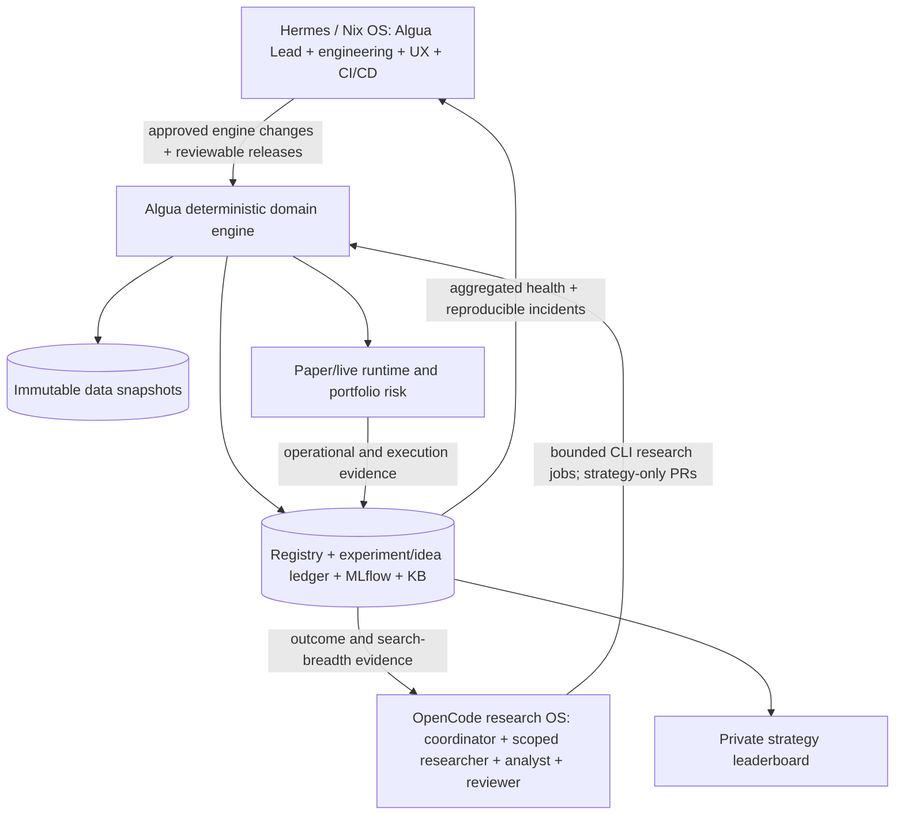

# Algua — Company/Research/Quant Architecture Design

**Date:** 2026-10-30  
**Status:** Approved target direction; not implemented  
**Repository path:** `docs/superpowers/specs/2026-10-30-algua-three-harness-design.md`  
**Normative product decisions:** [Vision of Record](../../PRD.md)  
**Implementation plan:** [three-harness plan](../plans/2026-10-30-algua-three-harness-implementation.md)

> **Provenance and status.** This publishes source package file `02_ARCHITECTURE_DESIGN.md`, SHA-256
> `fa179ebcdcf124ff4fd805cca68b15491ddbc179c69bc20421ddcf83c005c182`. The original source was proposed
> for owner review. Owner direction is approved: Lior approved this direction by mandate on
> 2026-10-30. The new controls described here are not implemented and are not operational permission.
> Hashes, baselines and blockers are in the
> [observed-target report](../../development/observed-target-report-2026-10-30-three-harness.md).
>
> **Precedence.** Where this design conflicts with current controls, the current controls win until a
> separately reviewed change replaces them: [PRD](../../PRD.md) §§18–19, `AGENTS.md`, `CLAUDE.md`,
> contracts, code and tests. Lior's approval is required for every merge and deployment. Passages
> below about automatic merge or deployment are TARGET and need separately reviewed authority; they
> are TARGET BLOCKED today. The subject matter below is otherwise the supplied design, reworded only
> where it read as a current instruction or linked into the source bundle. It is not a competing
> redesign.

## 1. Intent and success

Build the **complete intended** Algua research, portfolio and operator architecture while initially using **approximately two years of inexpensive real US-stock daily data**. The system must behave as the full target product now—self-directed OpenCode quant research, multimodal strategy contracts, reproducible numerical exploration, cumulative learning, strategy-first dashboard, portfolio allocation, fault recovery and controlled CI/CD—without paying for a premium point-in-time market dataset before the machinery earns confidence.

The initial data quality limits claims of investment alpha, **not the feature architecture or execution path**. Progress is validated with real-data experiments and actual scheduled paper operations, not only with synthetic fixture tests. The first engineering release is intentionally incremental; completion of each independently testable vertical slice moves toward this complete target.

## 2. Clear boundaries (one owner for each responsibility)



### Hermes / Nix OS — develop the machine

- One Hermes Algua Lead coordinates project engineering, UI/UX, data integration, safety upgrades, deployed release machinery and incident repair through its Kanban board.
- Specialists may be delegated coding, testing, operational diagnosis, UX review and CI/CD jobs under existing Nix OS scoped skills.
- Owns changes to `algua/data`, `algua/backtest`, `algua/research`, `algua/registry`, `algua/portfolio`, `algua/live`, `algua/execution`, `algua/operator`, the web monitor and platform configuration.
- Diagnoses failures from **structured aggregate telemetry** and exact artifact/commit references, not from direct arbitrary mutations of experiment rows.
- Reconciles Nix OS authority: GitHub for artifacts, Hermes Kanban for engineering tasks; Todoist for the human's commitments only.

### OpenCode — operate the research business

- One headless independent OpenCode research coordinator, with bounded specialist sessions for literature/inspirations, hypothesis design, strategy authoring, interpretation and **independent quant review**. Model/provider selection stays configurable per scoped role.
- Owns research campaigns, trial planning and economic hypotheses, and may author code under an allowlist of **new strategy files and approved strategy metadata**; cannot edit core engine, risk policy, gate logic, approvals or live deployment configuration.
- Research can operate while Hermes is offline. Failed agents generate bounded, durable failure records rather than requiring manual babysitting.
- Executes all numerical research via Algua's typed JSON CLI and batch engine; no free-form SQL writes, direct calls into privileged packages or LLM-controlled brokerage APIs.

### Algua — compute and control truth

- One modular Python monolith, one authoritative SQLite registry + existing tracking/KB surfaces, one canonical versioned snapshot store, deterministic evaluation and risk/portfolio/execution policies.
- One systemd research *initiation scheduler*, separate market-session-gated deterministic paper loop and any trusted merger/queue drain required by existing locks.
- Immutable strategy/model releases. The live planner is separate from the evolving working tree and accepts only a properly authorized frozen identity.
- Existing schema, code+config hashes, `t→t+1`, holdout accounting, approvals and reconciliation remain stronger than agent policy/prompts.

## 3. Minimal-data mode, full-system semantics

### Pilot dataset

- Ingest and pin roughly 150–300 symbol histories, approximately two recent years of real US listed daily OHLCV from existing `yfinance` adapter (`algua data ingest-bars`). Start with a liquid, observable **proxy universe** selected from available symbols; never label it a genuine historical small/mid-cap PIT universe.
- Every experiment, chart and report carries `data_tier = pilot_real_proxy`, explicit coverage dates, provider, snapshot hash, universe-generation method, known universe/survivorship gaps, missing delistings and event-timing limitations.
- Keep `synthetic_fixture` data solely for deterministic failure cases and interface tests. Later `verified_pit` data enters through the same provider/snapshot contracts, replacing only the provenance/coverage tier rather than the research engine.
- Daily refresh is an operational data job; pin a stable research dataset per campaign, and run fresh signal evaluation for paper sessions separately. Never silently mutate the dataset of a completed experiment.
- Historical `as_of` and *knowledge time* are distinct from download time. A vendor-derived value not available at decision time may not be used as past signal evidence. Mark missing historical company eligibility as unavailable rather than retroactively asserting it.

### Realism and honesty

- Results are actual realized historical backtests with fees/slippage, corporate-action treatment as available, and fixed observation windows. They are **weak preliminary research** due to short horizon and missing historical universe coverage; not authorized investment evidence.
- Do not lower protected minimum holdout length, point-in-time checks, test thresholds, risk controls, human approval rules or forward-session requirements to force candidate/paper/live counts.
- Because a 2-year sample may not support every gate, distinguish **machine acceptance** (the full machinery operates and honestly refuses unsafe promotion) from **investment acceptance** (full data and independent forward evidence).
- If the autonomous factory produces no qualified strategy, machine acceptance is still possible by verifying refusals, observed replay mechanics and a fully isolated simulated strategy for deterministic venue integration. Replays are never mislabeled as elapsed forward tests.

## 4. Universal strategy contract

The central abstraction is **Strategy = declared, versioned multimodal prediction function**, not a broker-connected day-trading bot.

**Suggested public semantics (types indicative; implementers must preserve existing `Strategy` interoperability):**

```python
@dataclass(frozen=True)
class AsOfContext:
    decision_ts: datetime                 # completed bar/session, timezone-aware
    universe: tuple[str, ...]             # effective as-of this decision
    features: Mapping[str, AsOfView]      # bars, fundamentals, news, filings, alternative
    models: Mapping[str, ModelHandle]     # pinned immutable model artifacts
    data_snapshot_ids: Mapping[str, str]  # provenance, versioned by source

class ResearchStrategy(Protocol):
    def score(self, context: AsOfContext) -> pd.Series: ...
```

`AsOfView` is a typed read-only facade with `kind`, `knowable_at`, required lookback, schema version and immutable data identity. New modalities are declaration/adapter additions, not new mutually exclusive `needs_*` forks. A strategy declares its **required** modality set; optional modalities are either explicitly marked or absent. Missing required data fails closed with a typed, recorded reason. A strategy must not see a later timestamp, unpinned model version, mutable storage, broker, environment secrets or internet access.

**Standard output:** a finite, duplicate-free `symbol -> score` series aligned to eligible as-of universe. No orders, stop prices or target cash amounts in the authored prediction. A deterministic construction policy converts scores into per-strategy target weights. ML training runs outside `score`, creates a versioned model artifact with training cutoff and full provenance, and binds the exact model at evaluation time. A news+ML+bars strategy may use all three inputs simultaneously.

Maintain the old strategy adapter while migrating **only if it is a tested transitional interface with a removal criterion**. Avoid two permanent strategy APIs.

## 5. Two levels of portfolio decisions

**Level A — within a strategy:** construct `symbol -> target_weight` from its score vector. Policies may include equal-weight top-K, score-proportional, volatility-adjusted exposure, cash reserve, constrained holding period and hysteresis. Stop-loss and take-profit research is valid but not the organizing approach.

**Level B — across strategies:** assign capped risk budgets to independently qualified strategies, taking uncertainty/volatility, shared holdings, family correlation, turnover and liquidity into account. Initial default is capped, volatility-aware allocation with conservative overlap controls, not an unconstrained Sharpe-maximizing optimizer. Net signed desired holdings and enforce account-level position, sector, turnover, available cash and gross/net exposure constraints before order construction. Support an empty/100%-cash solution.

**Decision timeline:** fully observed close at `t` -> compute legal targets -> earliest eligible fill at `t+1` (already embodied in `ExecutionContract`). Daily reevaluation need not result in daily trades. Explicit treatment of missing prices, missing target signals, corporate actions, entry/exit gaps and infeasible constraints. Preserve replay/paper/live decision parity.

The strategy may recommend exposure, but the authoritative portfolio and risk supervisors can always tighten or reject it. An AI agent can never directly place, change or cancel real orders.

## 6. High-throughput research operations (OpenCode)

### Campaign and experiment lifecycle

1. **Observe:** read machine health, data freshness/coverage and the research registry/previous negative outcomes. Query the family/idea ledger before duplicating work.
2. **Select:** maintain a bounded campaign portfolio across momentum, reversal, event/fundamental, ML and novelty. Allocate exploration/exploitation compute budget based on evidence, with a protected allocation to new families; record why each research decision was made.
3. **Hypothesize:** declare economic mechanism, falsifier, data dependencies, family/parent and maximum trials before opening validation evidence.
4. **Implement:** create strategy code in an isolated credential-free environment, version all models and configs, validate compatible modalities and available snapshots.
5. **Evaluate cheaply:** batch many deterministic rule/parameter variations; preflight schema, as-of, liquidity, cost and basic train/test integrity before consuming expensive evaluations.
6. **Evaluate rigorously:** use Algua's existing walk-forward, held-out evaluation, search-breadth counters and robustness gates without model discretion over raw verdicts. Count all trials, including failed/discarded and correlated variations.
7. **Interpret and review:** one independent reviewer challenges economic rationale, leakage, baseline comparison, selection effects and unreproducible results; **never** chooses the best-looking run retroactively as an authoritative representative.
8. **Record:** write all outcomes, refuted directions, lineage, data tier, run metadata, code/config/model identities and lessons to the existing authoritative registry and linked knowledge documents.
9. **Advance/learn:** the TARGET is allowlisted strategy-only PRs and paper-entry ceremonies where policy and genuine gates pass, with each merge needing Lior's approval until separately reviewed authority replaces that; otherwise choose the next hypothesis from cumulative evidence.

Each session has an idempotent ID, claim ownership, timeout, bounded retries, checkpoints and a terminal outcome (`completed`, `rejected`, `infrastructure_error`, `data_unavailable`, etc.). Resource limits govern CPU jobs, GPU-exclusive training, storage and model/provider budget. Session failure must not strand claims indefinitely or be counted as a negative financial result.

### No second workflow database

`algua/registry/`, `algua/tracking/`, and `algua/knowledge/` hold experiments, metrics, durable learning and provenance. Use Hermes Kanban only for *engineering work*, deduplicated incidents and owner decisions. Discord is an alert channel, not an evidence ledger. OpenCode group/session transcripts are not the research system of record.

## 7. Two-level improvement loop

**Research learning:** OpenCode reads a structured view of prior hypotheses, rejection reasons, positive and negative evidence, category yields, costs, diversity and compute spend. It chooses differentiated next work and periodically proves decisions actually changed from prior results. No self-reported improvement without reproducible before/after metrics.

**Engineering learning:** Algua's event/health outputs report provider errors, bad provenance, worker exits, stalled merge-back, CI failure, throughput regression and execution anomalies. Hermes deduplicates a specific problem into an owned Kanban card/GitHub issue with repro/expected result, delivers an independently reviewed fix and confirms the next operating cycle improves. Do not convert an unsuccessful economic hypothesis into a software bug.

Performance metrics: attempted and valid experiments per wall-hour/$/GPU-hour; family diversity; duplicates rejected; repeatability; pipeline stage yield with honest denominators; error rate and failed-recovery count; review latency; effective learnings reused; research system availability; strategy overlap/correlation; paper/live performance once valid. No single vanity throughput score.

## 8. Strategy-first dashboard

- **Home route `/`:** a clean strategy leaderboard with no persistent bottom four-tab bar. One row per registry strategy ID and the **latest** applicable gate run, never cherry-pick the best past evaluation. Stage tags from the real lifecycle, family, data quality tier, date, sample size, OOS Sharpe/return/drawdown and paper/live evidence as separate views.
- Filter by stage, family, data tier and time horizon; sort by any single observed comparable metric. Default: OOS Sharpe for rows with comparable evidence, with UNKNOWN/non-comparable entries visually separate and not falsely assigned ranks. Sorting is **exploratory**, never a promotion authority or a claim about expected profit.
- **Strategy details `/s/:id`:** lineage, signal/market rationale, backtest and walk-forward distributions, individual experiment runs and search breadth, costs, portfolio contribution, paper/live curves and health, associated frozen artifacts. Preserve a fallback redirect from legacy `/s/:name` where possible.
- **Secondary details:** top-level health indicator/alerts lead to research/ops diagnostics without competing primary tabs. Zero hidden safety warnings. Mobile-first 390px no horizontal overflow, accessible full metrics, stale/partial states explicit, no fabricated numbers.
- Source surfaces: `algua runs board` / `/api/strategy-board`, `web/frontend/src/components/StrategyBoard.tsx`, `web/frontend/src/screens/StrategyDetail.tsx`, `App.tsx` and existing UI tests. Current 'do not rank' research-board design is intentionally renegotiated for exploratory UI sorting; **do not** let its output feed promotion. The [supersession record](../../vision-reconciliation.md#strategy-leaderboard-supersession-2026-10-30) states what stays current until a separately admitted UI contract.

## 9. GitHub and VPS delivery

**Research automation (TARGET BLOCKED).** The target is auto-merge of *new allowlisted strategy modules and designated strategy docs only* after independent quant review + passing exact-head CI + safe diff policy. This needs separately reviewed authority; today every merge needs Lior's approval. The pre-existing trusted `paper merge-back` direct-main push must be reconciled with this rule; disable duplicate merge routes rather than layering a second writer on it.

**Engineering automation (TARGET BLOCKED).** The target has Hermes merge only expressly allowed code paths after independent engineering review, full CI and unchanged CODEOWNERS/gate policy. This needs separately reviewed authority; today every merge needs Lior's approval. Protected paths, signing anchors, approval logic, live risk/execution/security logic, credentials, and high-impact architecture changes require owner approval and review under the target too. Existing autowrite permissions are not universal authority.

**Deployment (TARGET BLOCKED).** Run untrusted PR tests on ephemeral GitHub-hosted runners or equivalent isolated compute; do not run arbitrary public-repo PR code on the secret-bearing VPS. In the target, CI produces immutable artifact digests, and a VPS deployer independently validates exact digest, serialized paper-operator quiescence and compatibility, applies an atomic versioned deployment, executes paper smoke tests, verifies health and rolls back to known-good **where schema permits**. A rollback must not ignore forward-only DB schema constraints; use safe-state halt when downgrade is unsafe. Existing live artifacts do not follow `main`; a paper release is not a live release. Until separately reviewed authority exists, every deployment needs Lior's approval.

**Critical strategy sandbox gate:** The present research author is worktree-isolated, but new Python strategy code merged into shared sources can execute inside authoritative/paper/live processes. A mere file allowlist does **not** make arbitrary code safe. Before expanding automatic strategy merge/activation, explicitly prove that all strategy code executing in a privileged environment is confined behind an enforced no-network/no-credentials/no-broker/no-authority process boundary with typed, validated decision output, or an equivalent reviewed control. Fail closed if that boundary cannot be demonstrated.

## 10. System acceptance and real-money boundary

**System validation on limited real data:** 10 unattended cycles, >=100 honestly recorded real-data trials, two or more families, reproducible reruns, a model + combined-input contract test, one fully verified independent review of each advancing candidate, working strategy leaderboard, multi-strategy allocation test, injected failure recovery, exact-head CI, an approved paper release/smoke/rollback drill, visible learning from prior runs, and independent scheduled paper operation with recorded completed-session ticks.

**Unacceptable shortcuts:** fake PIT market cap, fabricated fundamental/news timestamps, using synthetic backtests as live evidence, burning and reusing an independent holdout as if fresh, setting `actor=human` from an agent, lowering a required gate, changing live code under an existing approval, granting research OpenCode paper/live credentials, or merging unreviewed arbitrary strategy Python into privileged processes.

**Investment acceptance is separate:** purchase/verify deeper PIT data; improve out-of-sample and multiple-testing evidence; demonstrate genuine elapsed forward trading; verify immutable signer anchors, active capital/drawdown policy and broker/state safety; human-signed live activation only. No real-money orders are authorized by this design.

## 11. Migration principle and explicit non-goals

Incrementally **replace** duplicated OpenCode/Hermes coordination paths with the new responsibility split. Retain working deterministic Algua primitives, checks and systemd protections. Prefer deletion of redundant tasks/schedulers/bridges after parity is proven. No second task system, research database, MLflow instance, portfolio optimizer framework, execution fork or speculative microservices. No premium data purchases, external capital, discretionary day-trading bot, intraday SL/TP engine, or trading-risk relaxation as part of initial machine acceptance.

### Implementation decisions left to engineers (not new strategy policy)

Choose precise module names, run concurrency limits, risk-budget defaults, checkpoint implementation and vendor adapter details only after characterizing current behavior and writing differential tests; make these measured, configuration-driven defaults. Don't assign new owner permissions through implementation convenience. Record any irreversible authority or database migration as an explicit ADR for review.

## 12. Document and source reconciliation

1. Preserve and amend `docs/PRD.md`, `docs/architecture.md`, `docs/vision-reconciliation.md` and `docs/agent/operating.md`.
2. Update `docs/agent/story-delivery.md` from Todoist-as-agent-work-queue to Kanban-for-engineering and GitHub-for-evidence.
3. In a separate Nix OS PR, update `its-nix/os/profiles/algua/ROLE.md` for Hermes-as-developer/OpenCode-as-research-operator and any separately approved narrow merge rules; update relevant Nix OS specialists only through approved skill packs.
4. Reconcile the old OpenCode/Claude/Codex references, duplicate scheduler behavior and any previous frozen UI specs. Don't silently grant new capabilities through a markdown file.
