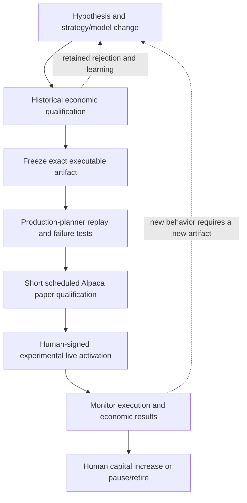

# Strategy delivery: historical qualification, short paper, experimental live

Date: 2026-11-07. Source baseline: `9f4fbce`.
Status: written design approved by the owner in conversation on 2026-11-07.
This document changes no executable policy, lifecycle edge, approval, allocation or service.

Owner reconfirmation, 2026-11-14: the historical-economic plus short-paper operational route is
the adopted experimental-delivery target, incorporated in PRD §16. It still requires protected
implementation. The 20% drawdown proposal below is not adopted: the 10% policy and separate
15% runtime default retain their distinct statuses under PRD §21.

## 1. Agreed objective and constraints

Deliver strategies quickly through one reproducible research-to-execution path. Judge economic
results by net percentage returns, benchmark contribution, risk-adjusted metrics, drawdown and
cost sensitivity. Judge delivery separately by completed experiments, reproducibility, reliable
operation and time to the next useful result.

The owner selected daily systematic research and information extraction as complementary tracks.
Potential future capital is approximately USD 50,000, conditional on results and subsequent human
capital decisions. The first experimental allocation remains within the existing ILS 2,000
envelope. Neither amount is funding or activation authorization.

The owner proposed 20% drawdown tolerance. Treat this as a requested risk-policy amendment, not
an applied setting, a per-trade risk budget or a guarantee of maximum loss. A 20% account drawdown
would require a 25% recovery. Reconcile the existing 10% intervention policy and the separate
generic 15% liquidating breaker explicitly before live activation.

## 2. Current source and reusable components

- `algua/backtest/context.py` and `run_inputs.py` already compose captured, as-of research inputs.
  `contracts/strategy_context.py` validates immutable context and finite eligible-symbol scores.
- The offline producer and `features/price_linear_context.py` already fit, pin and apply a small
  price-based linear model. Its historical-proxy labels do not establish historical availability
  or investment eligibility; see [model training](../../agent/model-training.md).
- `live/planner_contract.py` and frozen wire v1 transport bars, without model assets or sidecars.
  `strategies/tradable.py`, `registry/artifact_preparation.py` and `registry/frozen_view.py`
  deliberately refuse these unsupported trading inputs.
- Frozen paper execution, deployment epochs, invocation evidence and current-supervisor risk
  enforcement exist. Frozen live dispatch and deployment-bound live authorization remain work.
- Existing build/produce/adopt/release scripts under `deploy/scripts/` supply application release
  primitives. Reuse them and the registry, MLflow and KB; create no parallel release or experiment
  system. Application-artifact adoption is not strategy qualification or trading permission.
- `research/forward_gates.py` currently requires 63 daily return observations and a 95% one-sided
  Sharpe lower bound above the performance bar, with other mandatory checks. These remain active.

The recorded four empirical research cycles and the separate 100-configuration benchmark prove
bounded operation and retention, not a profitable strategy or a completed paper/live handoff.
See [cycle evidence](../../acceptance/research-vps-cycles.md) and
[benchmark](../../acceptance/real-sweep-benchmark.md). No current account or service was inspected
to produce this design.

## 3. Target delivery pipeline

The target separates three decisions. A positive result in one cannot substitute for another.

### Economic qualification

Use chronological development, validation and a final sealed historical test. The author and
selection process cannot inspect the final test before the strategy is frozen. Existing
burn-on-peek and measured search/family accounting remain; a previously inspected period does
not become untouched when a new campaign, registry or snapshot is created.

Training, scaling, feature selection and parameter choice use only available preceding inputs.
Separate overlapping target horizons appropriately at evaluation boundaries. Preserve existing
as-of masks and closed-bar decision to later-bar fill semantics. Record costs, capacity assumptions,
universe/delisting limitations, baselines, uncertainty and all searched variants. A positive raw
Sharpe is not a claim of statistical proof; current advisory robustness checks remain visibly
advisory until a reviewed economic-policy change explicitly makes them binding.

The economic-profile implementation is a separate protected change. It must version and persist
the selected criteria before evaluation, bind its result to exact inputs and identities, and
distinguish qualified evidence from exploration. This design does not choose an arbitrary new
Sharpe floor, make present advisory checks binding, or make the pilot eligible for investment.

### Operational qualification

Replay the production planner using captured inputs and a controlled clock. Exercise stale inputs,
restarts, interrupted submission, partial fills, cancellation and reconciliation using existing
integration seams. Synthetic failure cases establish software behavior, never profitability or
elapsed broker observations.

For the target short paper profile, use five actual completed scheduled exchange sessions as the
default engineering target. Each due session must have recorded input identity, a valid decision
or explicit safe refusal, and attributable effects. An unresolved refusal is not a clean release
qualification. Longer observation is necessary when required behavior has not been exercised.

Verify order submission/fill, cancellation and restart handling on the exact supported execution
path. A separate integration cohort can exercise these mechanics without manufacturing trades
for an economic candidate. Its synthetic or broker-test evidence must remain separate from the
candidate's returns. An unchanged platform component can reuse an applicable exact-version test;
changed decision behavior requires fresh evaluation. Five inactive days alone do not prove trading.

This profile is an execution qualification, not a short-sample profitability test. It is a proposed
replacement for the experimental path's long paper economic gate, not a relabeling of replay as
broker-clocked forward testing. The current `paper promote` behavior remains unchanged meanwhile.

### Capital authorization

Experimental activation requires qualifying historical evidence, operational qualification, the
exact recoverable artifact, an enforced capital/instrument/loss policy and authenticated human
authorization. Retain next-bar execution, long-only/unleveraged instruments, account reconciliation,
signer protection and the rule that agents cannot increase entrusted capital.

The human signs the exact deployment, applicable qualification profile/evidence, account/provider
and approved scope. No raw stage flag, CI success, archived report or injected certificate can
grant live authority. Legacy evidence is not silently converted to the new profile. Profile and
identity drift require requalification; any permitted recovery must preserve account state and
schema compatibility. Increasing capital is a separate human decision, never a reward triggered
automatically by a short profitable run.

## 4. First delivery: one pinned price model through frozen paper

Scope the first implementation specification to this vertical slice. It produces a reusable model
deployment path while leaving the investment and live-gate redesign separate.

1. Support one daily `context_v1` strategy using bars and one explicitly pinned price-linear model.
   Reuse the existing producer, codec, `ModelRef`/`ModelHandle` and pure scoring helper. Do not add
   training at inference, a new model framework, pickle loading, model grids or a second scorer.
2. Materialize the exact model bytes and training-provenance metadata into the immutable artifact.
   Validate the complete pin, byte digest and provenance on preparation and execution. Changing
   weights, scaler or provenance changes artifact identity. Execution must work after the mutable
   source model store becomes unavailable; it must never resolve `latest` or fall back to it.
3. Version the descriptor/planner/wire extension explicitly. Carry the captured bars identity,
   model identity and validated assets through the existing two-phase binding. Retain read/execute
   compatibility for existing bars-only artifacts; never reinterpret wire v1 as model-capable.
4. Build the same as-of context and call the same score/construction path in the canonical backtest
   and frozen planner. Required unsupported inputs fail closed. Do not erase modality declarations
   or add another legacy strategy interface. News/fundamentals remain refused until their own
   captured-input integration exists.
5. Keep acquisition, broker access, ledger writes, sizing/risk authority and order submission in
   the supervisor. Enforce the established authority-denying execution boundary before authoritative
   generated-strategy execution. A fresh child or replacement environment alone is not isolation.
6. Extend existing frozen paper admission/runtime and release verification only for the supported
   profile. Do not remove broad refusals until each supported input is verified. Preserve current
   candidate qualification, allocations and forward promotion; this slice cannot waive them.

The first reference model demonstrates delivery mechanics, not an endorsed trading strategy.
Use proxy data and synthetic fixtures only under their existing disclosures. If no genuinely
qualified candidate or paper account is available, complete the engineering checks and report
scheduled paper acceptance as unperformed. Never fabricate eligibility to make the slice green.

### First-delivery acceptance

- The same pin and captured bars give matching scores, weights and decision timing in canonical
  research and frozen execution. Numerical comparisons use existing parity tolerances, declared
  in the focused tests; no same-bar fill is introduced.
- Model tampering, a mismatched provenance digest, future training cutoff, wrong input snapshot,
  missing model, unsupported modality and phase-binding drift all refuse before order effects.
- A model artifact executes offline from its verified bundle with the mutable model store absent.
- A model/config/wire mismatch cannot inherit another deployment's evidence or authorization.
- Existing bars-only frozen artifacts retain their supported behavior. Unsupported profiles remain
  refused, rather than silently running with reduced inputs.
- Supervisor risk, recovery and JSON error behavior remain intact. Missing execution isolation
  refuses authoritative execution; a numerical parity fixture does not certify containment.
- Real paper acceptance uses actual scheduled sessions and broker readback when its prerequisites
  exist. Its result remains distinct from historical replay and investment qualification.

## 5. Subsequent deliveries and dependency order

| Delivery | Runnable outcome | Existing seams to extend |
|---|---|---|
| Model-capable frozen paper | One identical pinned model crosses research and frozen paper mechanics | Context, artifact preparation, frozen view/wire/child, paper dispatch |
| News/filing extraction | One timestamped event feature is reproduced in research and paper | Existing news storage/provider/context and the captured-input boundary; full-text/filings acquisition only for the selected hypothesis |
| Qualification profiles | Persisted economic evidence and short operational qualification have separate meanings and exact identity binding | Research/forward evidence, promotion and certificate readers; existing authority database |
| Immutable experimental live | The qualified artifact reaches Alpaca under signed deployment-bound authorization and an enforced envelope/pause | Existing Stories 2.3-2.6, shared supervisor and broker adapter |
| Strategy release automation | Reviewed source builds once; the same verified artifact progresses through permitted release stages | Existing CI, artifact producer/adopter, serialized paper release and recovery |

Collect prospective news while the first delivery is built. Evaluate source association, extraction
accuracy and incremental value against a simple baseline before expanding model complexity.
Current-collected timestamps do not become historical knowledge times. LLM experiments must retain
model/prompt/input/output identity and disclose unresolved training-contamination risk.

Use separate bounded implementation specifications for these deliveries. Do not make one giant
change to the gate, model protocol, live runner and loss policy. The program's dependency order
does not require finishing unrelated UI, new markets or a universal orchestration framework.

## 6. Reconcile existing policy before implementing live qualification

[Story 2.1](../../development/stories/2-1-refuse-live-qualification-on-relaxed-gates.md) and its
[contract](../../development/specs/spec-story-2-1-unrelaxed-live-qualification/SPEC.md) describe an
older direction under which even human-relaxed certificates cannot qualify for live. That target
conflicts with the newly agreed short-operational experimental route. Preserve its auditability,
explicit relaxation recording and no-agent-waiver objectives, but revise the qualification policy
through protected review before implementing or using the new route. Do not exploit the current
absence of that planned predicate as permission to bypass it.

Likewise, reconcile PRD capital policy and Stories 2.5/2.6 with the proposed 20% intervention
threshold. Preserve cash-flow-adjusted peak accounting, the approved pause/cancel behavior and
authenticated resumption. Decide how the existing liquidating breaker coexists with that policy
in the separate risk specification. This design does not silently amend those contracts.

`AGENTS.md` requires flagging safety-invariant and deferred-scope work for human decision. This
pass therefore changes documentation only. Protected implementation and any actual live ceremony
remain separate from agreement on product direction.

## 7. Delivery and verification

Start with the first-delivery specification and a small implementation plan mapped to the existing
files/tests above. Use focused parity, artifact, refusal and paper integration regressions. Run
lint/type/import-boundary checks proportionally when implementation changes those surfaces.
Use broader integration checks for protocol/migration/release changes; do not require a full-suite
rerun for this documentation change or every small commit.

No guaranteed P&L or calendar date follows from this pipeline. Once data and platform prerequisites
are met, historical evaluation and replay can run without waiting for new market sessions. The
short paper target adds approximately one market week, extended when required mechanics fail or
remain unexercised. It does not certify a durable edge or justify deploying the potential USD 50,000.

## References

- [Vision of record](../../PRD.md), [architecture](../../architecture.md),
  [delivery policy](../../agent/story-delivery.md), [bar contract](../../contracts/bar-schema.md).
- [Model registration](../../agent/model-artifacts.md),
  [price-linear components](../../agent/price-linear-components.md),
  [research memory](../../agent/research-memory.md).
- [Frozen live authorization](../../development/stories/2-3-bind-live-authorization-to-the-frozen-deployment.md),
  [frozen live handoff](../../development/stories/2-4-hand-off-and-execute-frozen-deployments-live.md),
  [capital envelope](../../development/stories/2-5-enforce-the-experimental-capital-envelope.md),
  [pause policy](../../development/stories/2-6-pause-live-trading-at-ten-percent-drawdown.md).
- [Man AHL shared platform](https://www.man.com/ahl),
  [Jane Street deterministic failure testing](https://blog.janestreet.com/getting-from-tested-to-battle-tested/),
  [Alpaca paper/live differences](https://docs.alpaca.markets/us/docs/paper-trading).
