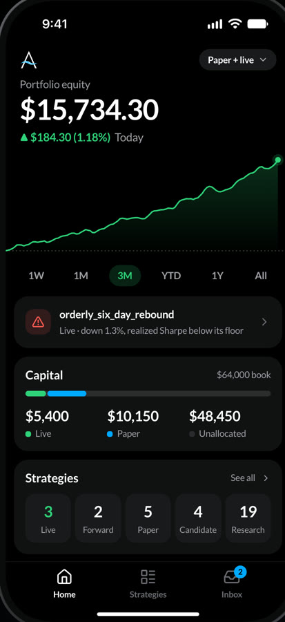
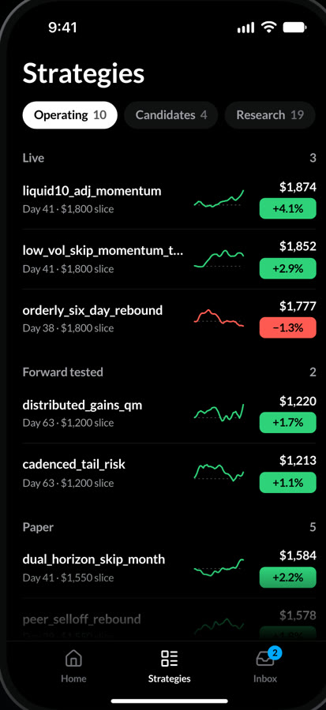
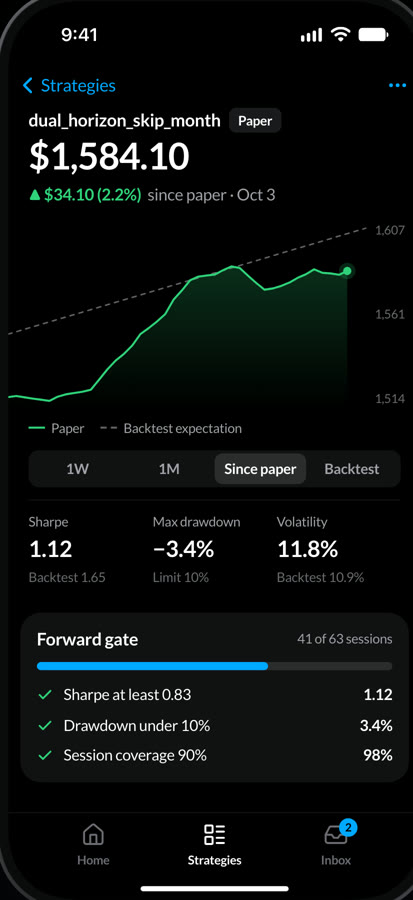
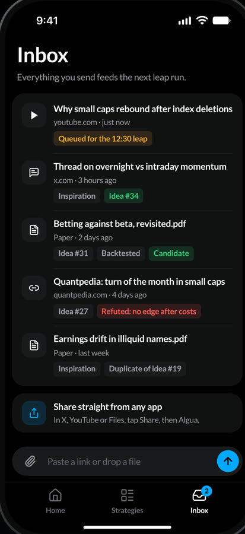

# Algua dashboard: one always-on screen for the owner (design)

Date: 2026-11-14. Status: approved mockups, design for review.

## 1. Intent

The owner wants to open one app on their phone and know, in five seconds, whether Algua is making
money: "I want to understand the equity curve, and hopefully see that it is going up, with the
ability to drill down to the metrics of each strategy to debug things when they do not go so well."
They also want to feed the ideation engine from the same place: "an inbox where I can upload
papers, X posts, YouTube videos, or whatever, and all will feed the ideation engine as an
inspiration point."

This replaces the Google Drive/Sheets ideation backend (merged in #817, live on the VPS since
2026-11-13). The owner decided Sheets cannot be both the single source of truth and a comfortable
view without mirrors, which they do not want: "I want a singular source of truth. I don't want
duplicates or mirrors." So every fact lives in exactly one place (the registry DB or the repo's
files), the dashboard is a live view of it, and the Inbox is the one place the owner writes.

## 2. The approved look

Mockups approved by the owner on 2026-11-14 ("it actually looks pretty good, i love it"). They are
the visual target; numbers in them are invented.

| Home | Strategies | Strategy | Inbox |
|---|---|---|---|
|  |  |  |  |

Style, as approved: true black (`#000`) ground, not dark gray ("an actual blackmode and not dark
mode"); cards `#111113`; Lato (Algua's brand font, `docs/brand/`); green `#2fd27a` / red `#ff5a52`
only for gains and losses; Algua ocean `#00a8ff` for interface accents (links, send, gate
progress); one big number per screen; iOS-like type scale 34/22/20/17/15/13/12 with nothing
secondary under 13px. Polish target: Robinhood, Revolut, Apple Stocks. The mockup source (React,
built with the stageshow kit) is outside the repo at `~/Projects/algua-dashboard-mockups/`; the
builder may read it for exact spacing.

## 3. Goals

1. **Home** answers "is the equity curve going up?": portfolio equity (paper + live, switchable),
   change today, the equity curve over 1W/1M/3M/YTD/1Y/All with a dotted line at the period's
   start, then what needs attention, where the capital is (live / paper / unallocated against the
   book), and how many strategies sit at each stage.
2. **Strategies** lists every operating strategy grouped by stage (Live, Forward tested, Paper),
   each with its own small curve, value and P&L chip; segments for Candidates and Research.
3. **Strategy** page: its own equity curve with the backtest's expectation drawn behind it
   (expected vs actual is the main debugging signal), the key metrics each beside its backtest or
   limit value (Sharpe, max drawdown, volatility, more on scroll), progress toward its next gate
   with each check, then recent trades and transitions.
4. **Inbox**: paste a link or drop a file; every item shows its journey (queued for the next leap,
   became an inspiration, became idea #N, then backtested / candidate / refuted / duplicate).
   Sharing from another app on the phone sends straight to the Inbox.
5. Always on, private, on the owner's phone and Mac.
6. Then remove the Drive backend completely, with nothing lost.

## 4. Non-goals

- No trading actions from the dashboard: no promote, transition, allocation, kill switch or
  go-live. It is read-only except for the Inbox. Live authority stays with the signed CLI
  ceremonies.
- No steering editor in v1 (categories and venues). After Drive is removed they return to what
  they were before #817: categories in the tracked `.opencode/categories.txt` (edited through git),
  venues in the runtime vault's `_sources.yaml` on the VPS (seeded from
  `deploy/kb/inspirations/_sources.yaml`). A steering screen can follow later.
- No push-notification redesign (the existing web-push plumbing stays as is).
- No desktop-specific layout beyond the phone layout scaling up sensibly.

## 5. Anti-goals (fails even if it works)

- A second copy of any fact that can drift (a mirror table, a synced sheet, a cached export the
  owner reads as truth).
- Reaching into modules or the DB directly from the web app. The CLI is the only seam.
- Exposing the app beyond the owner's tailnet, or any write without knowing it is the owner.
- Agents gaining a path to the outside through the Inbox (owner content is untrusted input to
  agents, exactly like foraged web content).

## 6. Constraints

- Build on the existing monitor in `web/` (FastAPI backend that only shells out to the `algua` CLI;
  React PWA frontend). It is a standalone uv project: web dependencies go in `web/uv.lock`, never
  the root `uv.lock` (its hash is part of gate identity).
- Every new fact the dashboard needs is exposed as a read-only `uv run algua ...` JSON command
  first; the web backend never queries the DB.
- Import-linter layering and the module-size ratchet apply (`docs/agent/operating.md`).
- Network: the backend binds `127.0.0.1` only; access is through `tailscale serve` (see
  `web/README.md`). The owner's phone (Android) and Mac are already on the tailnet with the VPS.

## 7. What changes, piece by piece

### 7.1 Navigation and theme (frontend)

Three tabs, in this order: **Home**, **Strategies**, **Inbox**, with an unread count on Inbox for
items whose status changed since last viewed. The existing screens are kept, not deleted: today's
Leaderboard and Research views move under Strategies → Research; Portfolio's table becomes part of
Home and Strategies. The theme switches to the black palette in §2 for both color schemes (the app
is black-only).

### 7.2 Data the screens need

| Screen part | Source |
|---|---|
| Portfolio equity curve and value | **New** read-only CLI `algua fleet equity [--lane paper|live] [--since D]`, built from the same tick snapshots `fleet series` reads. The big number is today's total equity. The **curve answers "is it making money?"**: it is P&L-indexed (cumulative gains and losses from the period start), so allocating, releasing or moving capital between strategies or lanes never shows as a jump. "Paper + live" is the combined total; the toggle offers Paper and Live alone. |
| Today's change, range changes | Derived from `fleet equity`. |
| Needs attention | Existing `/api/triage` (fleet + ops + book). |
| Capital split | Existing `/api/book` (allocated slices by lane, book size). |
| Stage counts | Existing `registry list` / `/api/strategies`. |
| Strategy rows and curves | Existing `/api/strategies` + `fleet series <name>`. |
| Strategy curve | Existing `fleet series <name>`. |
| Backtest expectation line | The strategy's passing research-gate holdout record (annualized holdout return compounded per session from the stage-entry value). The builder chooses where to read it from among existing gate commands; if none exposes it, add it to the strategy detail CLI output. |
| Metrics with backtest/limit beside them | Existing gate and paper records already behind `/api/strategy/{name}`; paper-promote thresholds for the gate card. |
| Inbox items and journeys | **New** `algua research inbox list` (§7.3). |

### 7.3 The Inbox

**Storage: one table, owned by the registry.** A new migration adds `inbox_items`:
`id`, `created_at`, `kind` (`link` | `file` | `text`), `url`, `title`, `note` (the owner's own
words, optional), `file_path`, `text` (extracted readable text, bounded), `status`
(`queued` | `taken`), `taken_at`, `inspiration_id`. The journey after "taken" is not stored here;
it is joined live from the inspiration and the existing idea/inspiration links
(`idea_inspirations`) and idea outcomes, so nothing is duplicated.

**CLI (the only writer):**
- `algua research inbox add --url U [--note N] [--title T]`, `--file PATH`, or `--text T`, which
  emits the new item.
- `algua research inbox list [--limit N]`: items newest first with their joined journey.
- `algua research inbox intake`: already exists for Drive. It is re-pointed at the table and run by
  `leap.sh` at the start of each firing, as today. Each queued item becomes exactly one
  `source_kind: human` inspiration, keeping today's rules: processed first, the 2-day pool-depth
  bypass, `inbox_row_id` → `inbox_item_id`.

**Web endpoints (the first writes in this app):**
- `POST /api/inbox` (JSON link/text, or multipart file) calls `research inbox add`.
- `GET /api/inbox` calls `research inbox list`.
- Owner check on every write: `tailscale serve` adds the `Tailscale-User-Login` header; the backend
  accepts a write only when it equals `ALGUA_WEB_OWNER_LOGIN` (env, set on the VPS), and refuses
  any request without it. Reads stay as today.
- The header is only trustworthy if nothing but `tailscale serve` can reach the backend. A TCP
  loopback port is reachable by every process on the VPS, agents included. So the backend listens
  on a **Unix socket** in a directory only the web service's user can open (tailscaled runs as root
  and can), and `tailscale serve` proxies to that socket. If the installed tailscale cannot proxy to
  a Unix socket, the fallback is a loopback port plus a confirmed, tested sandbox network denial for
  agent runs.

**What gets extracted (my call, see §9):**
- PDFs and other text files are saved under the data root (`<data>/inbox/<id>/`). The web backend
  extracts their text (pypdf, in `web/uv.lock`) and passes it, truncated to the inspiration size
  limit (`MAX_NOTE_BYTES`), to `inbox add`.
- Article links: the backend fetches the page title and readable text once, best effort, with a
  short timeout and size cap, http(s) only, no private addresses.
- X and YouTube links in v1: the link plus the owner's note. The UI encourages a one-line "why"
  for these.

**Share from the phone:** the PWA manifest declares a Web Share Target (`share_target`) that posts
to the Inbox, so on Android, Share → Algua sends a link, text or file straight in. iOS does not
support share targets for web apps; there, paste is the path.

**Agents:** the inspiration carries the URL, note and extracted text as untrusted content, exactly
like foraged notes. Agents still never get the network or the token beyond what they have today.

### 7.4 Deployment

A systemd unit `algua-web` per `web/README.md` (but listening on the Unix socket from §7.3), adapted to the VPS layout (the ideation units run
from `/home/algua/Projects/algua` via drop-ins, not `/opt/algua`). It needs:
- the root `uv sync` and `web` sync;
- the frontend built with `npm ci && npm run build`;
- `tailscale serve --bg https:443 http://127.0.0.1:8787`;
- `ALGUA_WEB_OWNER_LOGIN` set.

The owner installs the PWA from `https://<box>.<tailnet>.ts.net` on their phone.

### 7.5 Removing Drive (in the same release as the Inbox)

One release switches everything, so no intake path ever runs against both backends: the funnel goes
back to files, the Inbox table goes live, and Drive goes, in one deploy.

1. Port the current Sheets content back once:
   - `research steering export --to DIR` already writes the file format.
   - Copy its `inspirations/*.md` and `_sources.yaml` into the VPS's **runtime vault**
     (`kb/inspirations/`). That folder is git-ignored on purpose: it now holds the owner's notes and
     paper text, and this repository is public. Never commit it.
   - Copy `categories.txt` over the tracked `.opencode/categories.txt` only if it differs, and
     commit that one file.
   - Record note, venue and category counts before and after; they must match.

   Any rows in the Drive Inbox not yet taken are re-added through `research inbox add` after the
   deploy.
2. Remove the Drive code and wiring:
   - code: `algua/knowledge/drive/`, `cli/_drive.py`, `steering_cmd.py`, Drive `inbox`/`publish`
     commands, the settings fields, the import-linter Drive contract, Drive tests;
   - drivers: the Drive branches in `leap.sh`, `forage.sh` and `run-research-loop.sh`, and
     `scripts/drive_consent.py`;
   - docs: `docs/agent/drive.md`, the `kb/drive-assets.md` exception, the `CLAUDE.md` bullet.

   Keep `run_agent.sh`'s credential stripping (harmless and still correct).
3. On the VPS: remove the two `ALGUA_DRIVE_*` lines from `research.env` and delete
   `/home/algua/.config/algua/drive.json`.
4. The owner revokes the app's access in their Google account and may delete the `algua-drive`
   Cloud project and the `My Drive/Nix/Ventures/Algua/Ideation` folder. These are owner actions;
   the assistant only lists them.

## 8. Done when

- On the owner's phone over the tailnet, Home shows the real portfolio curve, and tapping through
  to any operating strategy shows its curve against its expectation and its gate progress.
- A link, a PDF and an Android share each land in the Inbox, appear as one inspiration each after
  the next leap firing, and their journey updates as ideas move. Nothing is processed twice.
- Drive is gone from code and the VPS, with no inspiration, venue or category lost (counts before
  and after match).
- Focused tests: new CLI commands (unit + JSON shape), the owner check (refuses without/with wrong
  header), intake exactly-once against the table, extraction bounds, the frontend screens against
  fixtures (the demo build keeps working).

## 9. Calls I made (owner can overturn)

- **Inbox in the registry DB, not files**: exactly-once and the journey join are natural there; the
  inspirations themselves stay where the funnel already reads them. *If wrong:* a table to drop.
- **Owner check via Tailscale identity header behind a Unix socket**, not a login screen: the
  tailnet already is the boundary; the socket makes the header unforgeable from the box itself.
  *If wrong:* add a passcode later.
- **P&L-indexed home curve**, not raw summed equity: capital moves would otherwise look like gains.
  *If wrong:* a curve the owner reads differently; switching the index is a CLI change.
- **One cut-over release** for Inbox + Drive removal: no dual intake path to build and test. *If
  wrong:* a few hours without an Inbox during the deploy.
- **X/YouTube text not fetched in v1** (link + note only): those sites block simple fetching and
  transcripts need extra machinery. *If wrong:* the agent works with less context on those items
  until a fetcher is added.
- **No steering editor in v1**: keeps the first write surface to one table. *If wrong:* categories
  and venues are edited via git a while longer.
- **Black-only theme**: as requested; the light theme is dropped.

## 10. Left to the builder

Component structure, chart library or hand-drawn SVG (the mockups use a simple min/max-scaled SVG
line with light smoothing), exact aggregation for `fleet equity` across lanes and missing
sessions, the unread-count rule, caching TTLs, and the order of migration numbers.
